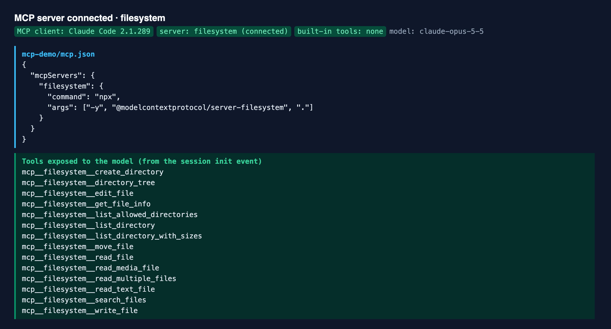
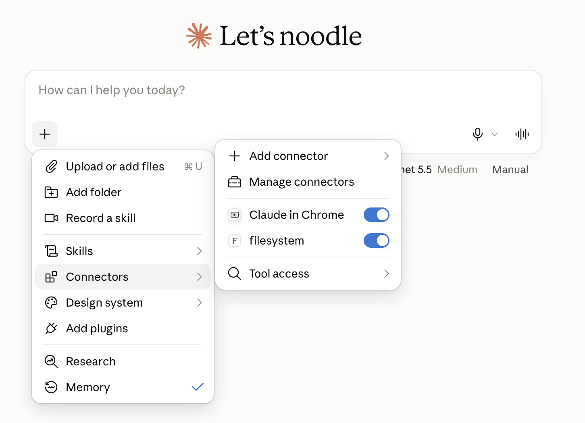
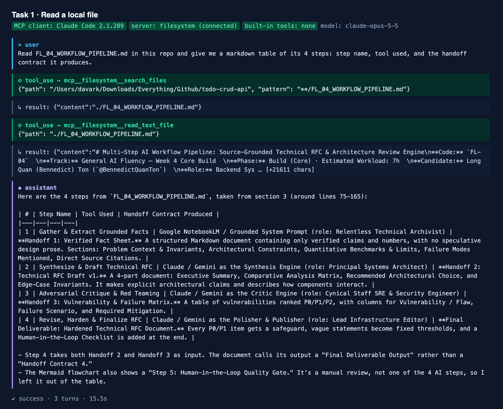
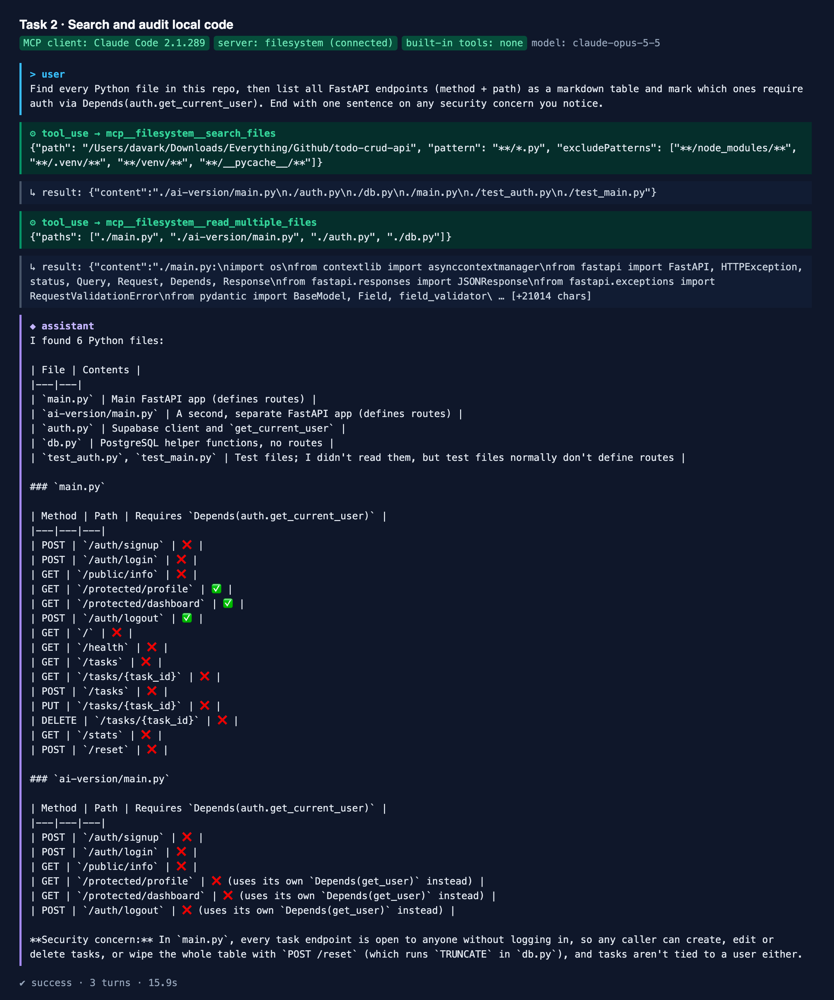
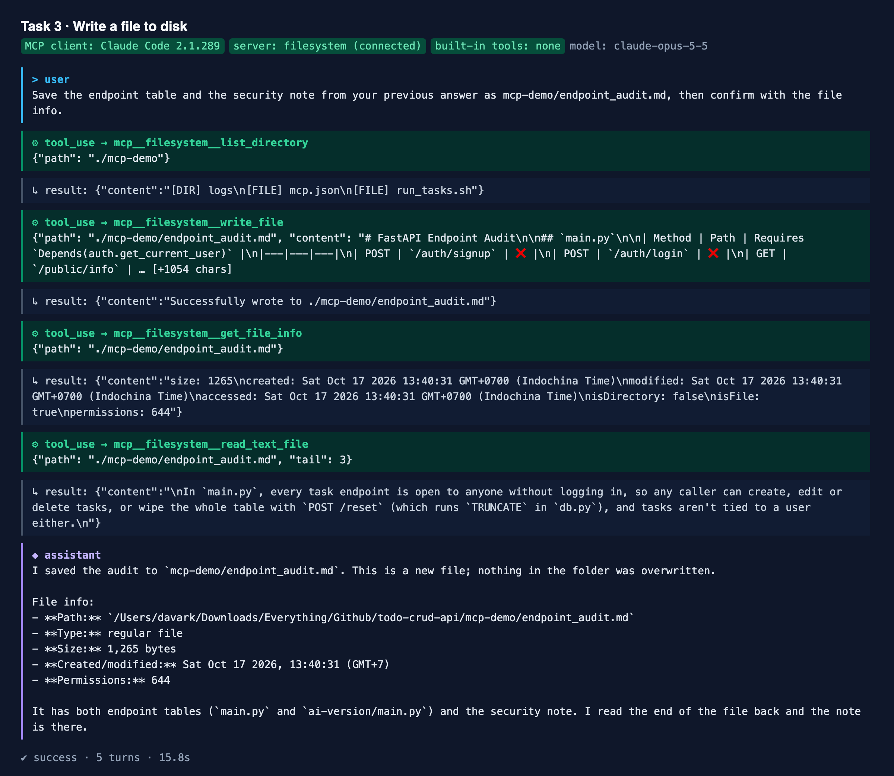

# Agents vs Workflows & MCP: Classifying My FL-04 Pipeline
**Track:** General AI Fluency — Build (core) · Estimated hours: 5  
**Program:** FlyRank AI Internship  
**Candidate:** Long Quan (Bennedict) Ton (`@BennedictQuanTon`)  
**Repository:** [BennedictQuanTon/todo-crud-api](https://github.com/BennedictQuanTon/todo-crud-api)  
**Related build:** [FL-04 Multi-Step AI Workflow Pipeline](FL_04_WORKFLOW_PIPELINE.md)

---

## 1. Explainer: Agents, MCP, and My FL-04 Pipeline

### What an agent actually is

When people say "agent" they often mean any app with an LLM inside. After reading Anthropic's *Building Effective Agents*, I use a narrower definition. The question is: **who decides the next step?**

In a **workflow**, I decide. The steps are written down before the run starts: step 1 does this, its output goes to step 2, and so on. The LLM does the thinking inside each step, but it never chooses the path. Anthropic lists the common shapes: prompt chaining, routing, parallelization, orchestrator-workers and evaluator-optimizer. They are predictable, easy to debug, and I know in advance how many calls a run will take.

In an **agent**, the model decides. It gets a goal and a set of tools, then runs in a loop: pick an action, call a tool, look at the result, pick the next action. It stops when it thinks the job is done or when it hits a limit such as a maximum number of turns. The key is feedback from the environment. An agent reads a file, runs a test or queries a service, and what comes back changes what it does next. That is also why agents cost more and are less predictable: the number of steps is unknown up front, and an early mistake can compound.

The advice that stayed with me: start with the simplest thing that works. One good prompt first, then a workflow, and an agent only when the task needs flexible decisions I cannot hard-code.

### My FL-04 pipeline is a workflow

My FL-04 build, the Source-Grounded Technical RFC & Architecture Review pipeline, is clearly a workflow. It has four fixed steps: ground facts from sources in NotebookLM, draft an RFC, run an adversarial critique, revise using the critique, then a human review gate. The order never changes. The model never chooses which sources to read, because I upload them. It never decides to go back to step 1: if the critique finds a weak fact, I am the one who notices and re-runs. I even carry every handoff between tools by copy and paste. In Anthropic's terms it is **prompt chaining with a gate**, and steps 3 to 4 are a single-pass evaluator-optimizer. Calling it an "AI agent" would be marketing.

That is not a weakness. For a document I need to trust, a fixed path with a human checkpoint is the right default.

### What MCP is

The other limit of my pipeline is that the model only sees what I paste into it. The **Model Context Protocol (MCP)** is an open standard that fixes this. The docs call it a USB-C port for AI applications: instead of every app building a custom integration for every data source, a source is wrapped once as an **MCP server**, and any **MCP client** (Claude Desktop, Claude Code, an IDE) can plug into it.

A server can offer three primitives:
- **Tools**: functions the model can call, such as `read_text_file`, `write_file` or "run this SQL query". The model decides when to use them.
- **Resources**: data the application attaches as context, such as a file or a database schema.
- **Prompts**: reusable templates the user picks, such as a slash command.

For this assignment I connected the official Filesystem server to Claude Code as the MCP client, scoped to my `todo-crud-api` repo, with all of Claude Code's built-in tools switched off so that MCP was the only way in. Claude could then read my files, search my code and write a new file to my disk. A normal chat can do none of that; it can only guess or ask me to paste.

MCP and agents are related but not the same thing. MCP gives a model hands. An agent is the loop that decides when to use them. A workflow can call MCP tools at fixed steps, and an agent without tools is just a chatbot talking to itself.

### What FL-04 needs to become an agent

The concrete upgrade: **turn Step 1 and the critique into a self-directed research loop.**

1. Give the model MCP tools: Filesystem (my repo's code and docs) and Fetch (official documentation pages).
2. Give it a goal instead of a script: "Produce an RFC for <topic> where every claim is backed by a source."
3. Let it choose which sources to read, write the draft, and critique its own draft.
4. If the critique finds a P0 issue or a claim marked `UNSPECIFIED IN SOURCE`, the model goes back, fetches more evidence itself and revises.
5. Stop when no P0 items remain or after three rounds, whichever comes first.
6. Keep my human review gate at the end. Architecture advice still needs a person to check the numbers.

The test for whether this is really an agent: two runs on different topics should take different paths, read different sources and loop a different number of times. Today every FL-04 run follows exactly the same path. That difference is the line between a workflow and an agent.

---

## 2. Workflow vs Agent: FL-04 Classification Summary

| Question | FL-04 today | Agent version |
| :--- | :--- | :--- |
| Who picks the next step? | Fixed order, written by me | The model, based on tool results |
| Who picks the sources? | I upload them to NotebookLM | The model, via MCP Filesystem + Fetch |
| Can it loop back? | Only if I re-run it by hand | Yes, until no P0 remains (max 3 rounds) |
| How do handoffs move? | Copy and paste between tools | Inside one tool-using loop |
| Number of LLM calls per run | Always 4 | Varies by topic |
| Human gate | Yes | Yes (kept) |
| **Classification** | **Workflow: prompt chaining + gate** | **Agent** |

---

## 3. MCP Setup Evidence

### Setup
- **Client:** Claude Code CLI 2.1.289, run headless (`claude -p`)
- **Server:** [`@modelcontextprotocol/server-filesystem`](https://github.com/modelcontextprotocol/servers/tree/main/src/filesystem) (stdio transport, runs locally via `npx`)
- **Scope:** read/write access limited to this repository only
- **Isolation:** `--tools ""` disables every built-in Claude Code tool and `--strict-mcp-config` loads only this server. The model's tool list (screenshot below) contains nothing but `mcp__filesystem__*`, so every file access in the three tasks went through MCP.

[`mcp-demo/mcp.json`](mcp-demo/mcp.json):
```json
{
  "mcpServers": {
    "filesystem": {
      "command": "npx",
      "args": ["-y", "@modelcontextprotocol/server-filesystem", "."]
    }
  }
}
```

Reproduce with [`mcp-demo/run_tasks.sh`](mcp-demo/run_tasks.sh). The raw transcripts (stream-json, every tool call and result) are in [`mcp-demo/logs/`](mcp-demo/logs/). The screenshots are rendered from those logs by [`mcp-demo/render_evidence.py`](mcp-demo/render_evidence.py).



The same server is also registered in Claude Desktop (`claude_desktop_config.json`) and shows up as an enabled connector there. One lesson from trying it in Desktop: without explicit instructions, Desktop chose to clone the repo from GitHub into its own sandbox instead of calling the connector, and the server log showed zero `tools/call` requests. Having a connector enabled does not mean the model uses it. That is why the evidence below comes from the run where MCP was the only way in.



### Task 1: Read a local file
- **Prompt:** "Read FL_04_WORKFLOW_PIPELINE.md in this repo and give me a markdown table of its 4 steps: step name, tool used, and the handoff contract it produces."
- **Tool calls:** `search_files` → `read_text_file`
- **Why chat alone could not do it:** the file exists only on my laptop; a plain chat has no access to my disk.
- **Result:** Claude found and read the file and returned a correct 4-row table: Gather & Extract Grounded Facts (NotebookLM → Verified Fact Sheet), Synthesize & Draft RFC (→ RFC Draft v1), Adversarial Critique (→ Vulnerability & Failure Matrix), Revise & Finalize (→ Hardened RFC).
- **Log:** [`task1_read_file.jsonl`](mcp-demo/logs/task1_read_file.jsonl)



### Task 2: Search and audit my code
- **Prompt:** "Find every Python file in this repo, then list all FastAPI endpoints (method + path) as a markdown table and mark which ones require auth via Depends(auth.get_current_user). End with one sentence on any security concern you notice."
- **Tool calls:** `search_files` → `read_multiple_files`
- **Why chat alone could not do it:** it had to discover which files exist and read the real current code, not guess from memory.
- **Result:** Claude found 6 Python files and listed 15 endpoints in `main.py`. Only `/protected/profile`, `/protected/dashboard` and `/auth/logout` require auth. It flagged a real issue: all `/tasks` endpoints and `POST /reset` (which runs `TRUNCATE`) are open to anyone, and tasks are not tied to a user. That finding is now on my backlog.
- **Log:** [`task2_endpoint_audit.jsonl`](mcp-demo/logs/task2_endpoint_audit.jsonl)



### Task 3: Write a file to my disk
- **Prompt (same session as Task 2):** "Save the endpoint table and the security note from your previous answer as mcp-demo/endpoint_audit.md, then confirm with the file info."
- **Tool calls:** `list_directory` → `write_file` → `get_file_info` → `read_text_file` (verify)
- **Why chat alone could not do it:** a chat can only show text; it cannot create a file on my machine.
- **Result:** a new 1,265-byte file was written and read back to verify it. It is committed here: [`mcp-demo/endpoint_audit.md`](mcp-demo/endpoint_audit.md).
- **Log:** [`task3_write_file.jsonl`](mcp-demo/logs/task3_write_file.jsonl)



---

## 4. Evaluation Criteria Checklist

- [x] **Explainer technically correct and in my own words:** Section 1 (600–900 words).
- [x] **Workflow vs agent applied to FL-04:** classified as a workflow (prompt chaining + human gate), Sections 1 and 2.
- [x] **Connector demonstrably working:** screenshots and raw logs in Section 3 show `mcp__filesystem__*` tool calls, with built-in tools disabled.
- [x] **Three tasks chat alone could not do:** read a local file, search and audit local code, write a file to disk.
- [x] **One concrete agent upgrade named:** self-directed research loop with MCP Filesystem + Fetch, P0-based stop condition, max 3 rounds, human gate kept.
