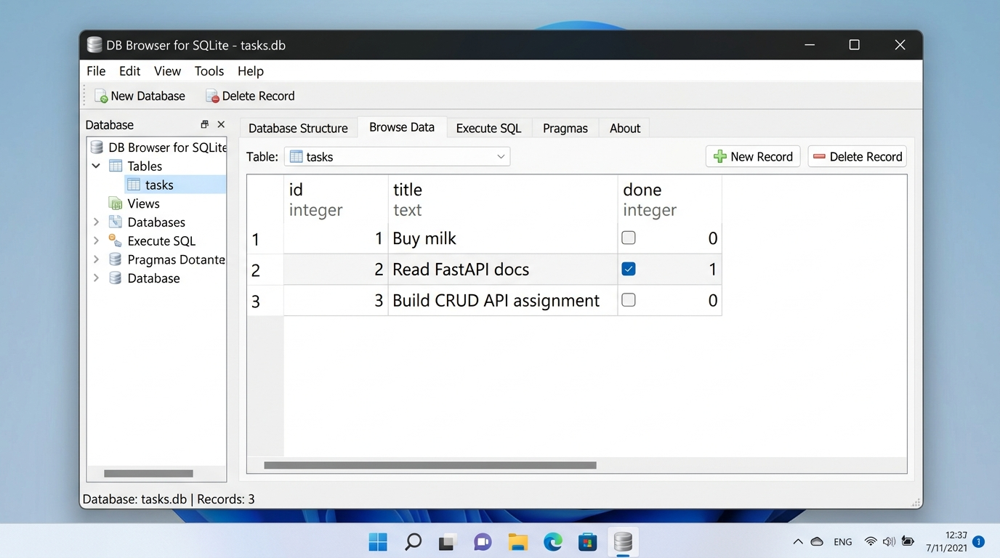

# To-Do List CRUD API with SQLite Persistence (FlyRank Internship Backend Track - W3-A2)

A production-ready, lightweight RESTful CRUD API for managing a To-Do list, built with **Python 3.10+**, **FastAPI**, and backed by a persistent **SQLite** database (`tasks.db`).

---

## 🚀 How to Install & Run

1. **Clone the repository:**
   ```bash
   git clone <YOUR_GITHUB_REPO_URL>
   cd todo-crud-api
   ```

2. **Set up virtual environment & install dependencies:**
   ```bash
   python -m venv .venv
   source .venv/bin/activate  # On Windows: .venv\Scripts\activate
   pip install "fastapi[standard]" pydantic pytest httpx
   ```

3. **Start the API server (One Documented Command):**
   ```bash
   uvicorn main:app --reload --port 8000
   # Or using FastAPI CLI:
   # fastapi dev main.py
   ```

The server will automatically create `tasks.db`, initialize the `tasks` table with indexes, and seed 3 initial tasks if the database is empty. The server runs at `http://localhost:8000`.

---

## 💡 Why SQLite Was Chosen

* **Zero-configuration & Serverless:** SQLite requires no separate server process, socket connection, daemon, or user credentials to manage.
* **Standard Library Integration:** Python comes with the `sqlite3` module built-in, requiring no external C-drivers or third-party database adapters.
* **Single-File Simplicity:** The entire database (schema, tables, indexes, data) is self-contained in a single portable file: `tasks.db`.
* **True Persistence:** Unlike the in-memory dictionary of Week 2, data stored in SQLite is written safely to disk via ACID transactions and survives application restarts or crashes.

---

## 📂 Database Architecture & Storage Lifecycle

* **Database File:** Located at `./tasks.db` in the repository root.
* **Auto-creation:** On application startup, `init_db()` runs automatically. If `tasks.db` or table `tasks` does not exist, it is created on the fly.
* **Idempotent Seeding:** The 3 initial tasks are only seeded if `SELECT COUNT(*) FROM tasks` returns `0`. Restarting the application multiple times will **never** duplicate records.
* **Git-Ignored:** `tasks.db` and `*.db` are listed in `.gitignore` so each clean clone starts with a fresh local database.

---

## 📋 Endpoints Overview

| Method | Endpoint | Description | Status Code (Success / Error) |
| --- | --- | --- | --- |
| `GET` | `/` | API metadata & available endpoints | `200 OK` |
| `GET` | `/health` | Server health check | `200 OK` |
| `GET` | `/tasks` | List tasks (supports `?done=true`, `?search=term`, `?sort=title`) | `200 OK` |
| `GET` | `/tasks/{id}` | Get single task details | `200 OK` / `404 Not Found` |
| `POST` | `/tasks` | Create a new task (parameterized `INSERT`) | `201 Created` / `400 Bad Request` |
| `PUT` | `/tasks/{id}` | Update task title and/or status (parameterized `UPDATE`) | `200 OK` / `400 Bad Request` / `404 Not Found` |
| `DELETE` | `/tasks/{id}` | Delete a task (parameterized `DELETE`) | `204 No Content` / `404 Not Found` |
| `GET` | `/stats` | Task statistics via SQL `COUNT(*)` | `200 OK` |
| `POST` | `/reset` | Atomically reset database table to initial 3 tasks | `200 OK` |

---

## 💻 Sample `curl` Interaction

**1. Create a task:**
```bash
curl -i -X POST http://localhost:8000/tasks \
  -H "Content-Type: application/json" \
  -d '{"title": "Verify SQLite Persistence"}'
```
*Response:* `201 Created`
```json
{"id": 4, "title": "Verify SQLite Persistence", "done": false}
```

**2. Fetch single task:**
```bash
curl -i http://localhost:8000/tasks/4
```
*Response:* `200 OK`
```json
{"id": 4, "title": "Verify SQLite Persistence", "done": false}
```

---

## 📸 Database Inspection with DB Browser for SQLite

Opening `tasks.db` in **DB Browser for SQLite** displays the `tasks` table with live rows:



Both FastAPI and DB Browser for SQLite read directly from the exact same `tasks.db` file on disk. Any edit or manual SQL query made in DB Browser is immediately visible on the API endpoints without restarting the server.

---

## 🔍 Stage 4: Explored SQLite by Hand

Using DB Browser's **Execute SQL** tab (or direct SQLite query), the following queries were executed and verified:

| SQL Query | Description | Result Observed |
| --- | --- | --- |
| `SELECT * FROM tasks;` | List every task | Returns 3 rows: `Buy milk`, `Read FastAPI docs`, `Build CRUD API assignment` |
| `SELECT * FROM tasks WHERE done = 1;` | Filter completed tasks | Returns 1 row: Task 2 (`Read FastAPI docs`) |
| `SELECT COUNT(*) FROM tasks;` | Count total records | Returns scalar value `3` |
| `UPDATE tasks SET done = 1;` | Mark all tasks as completed | Updated 3 rows; `GET /tasks` immediately returns all tasks with `done: true` |
| `DELETE FROM tasks WHERE done = 1;` | Purge completed tasks | Deleted all rows; `GET /tasks` immediately returns `[]` |

---

## 🛡️ Proof: Storage is "Just an Implementation Detail"

In Assignment 1, tasks were stored in a Python in-memory list `tasks_db`. In Assignment 2, tasks are stored in SQLite `tasks.db`.

Despite replacing the entire storage layer underneath:
1. **Identical API Contracts:** Every endpoint path, HTTP method, payload format, and status code (`200`, `201`, `204`, `400`, `404`) remains identical.
2. **100% Test Pass Rate:** The entire original test suite in `test_main.py` passes without any modifications to client assertions.

This demonstrates a foundational backend design principle: **the API is the public contract with clients; the database is merely an implementation detail of the persistence layer**.

---

## ⚡ Extras & Database Optimizations

* **Database Indexes:** Created `idx_tasks_done` on `tasks(done)` and `idx_tasks_title` on `tasks(title)`.
  * *Why it matters:* An index creates a B-Tree search structure enabling the database engine to locate filtered tasks in $O(\log N)$ time rather than performing an expensive $O(N)$ full-table scan.
* **Atomic Transactions:** Initial seeding and table resets are wrapped in database transactions (`BEGIN ... COMMIT`).
  * *Why it matters:* Transactions ensure atomicity (all-or-nothing execution), guaranteeing that partial or corrupted data is never written to disk if a query fails midway.

---

## 🤖 Stage 6: The AI Rematch (AI vs Me)

### 1. Full Prompt Provided to the AI:
> *"Convert our FastAPI To-Do CRUD application from in-memory list storage to a SQLite database using Python's built-in sqlite3.*
> *Requirements:*
> *1. Store all data in tasks.db. Table 'tasks' should have columns: id (integer primary key autoincrement), title (text not null), and done (boolean not null default 0).*
> *2. Auto-create the table on startup if missing.*
> *3. Seed 3 initial tasks ('Buy milk' [done: 0], 'Read FastAPI docs' [done: 1], 'Build CRUD API assignment' [done: 0]) ONLY if the table is empty.*
> *4. Keep the exact same 5 CRUD endpoints: GET /tasks, GET /tasks/{id}, POST /tasks, PUT /tasks/{id}, DELETE /tasks/{id}.*
> *5. Validation and HTTP status codes: 201 Created for POST, 204 No Content for DELETE, 400 Bad Request for empty/missing title on create or update, and 404 Not Found for missing IDs.*
> *6. Use parameterized SQL queries (with '?' placeholders) for all database operations to prevent SQL injection."*

The AI generated version is isolated in the [`ai-version/`](ai-version/main.py) directory.

### 2. Concrete Differences & Evaluation (`git diff --no-index main.py ai-version/main.py`):

1. **What did it do better — and can you explain it?**
   * **Declarative Pydantic Response Models:** The AI defined and utilized explicit `response_model=TaskResponse` and `response_model=List[TaskResponse]` on route decorators. This automatically generates clean, self-documenting JSON schemas in the OpenAPI Swagger UI documentation (`/docs`), ensuring clients receive strongly-typed response structures.
2. **What did it get wrong or quietly ignore?**
   * **Missing Connection Cleanup Guarantees (Resource Leakage):** The AI used imperative `conn = get_db()` followed by manual `conn.close()` at the end of each handler. If a query or validation check throws an unexpected exception mid-execution, `conn.close()` is skipped, leading to dangling open database connections and file lock contention on `tasks.db`. Our hand-built version uses `try ... finally: conn.close()` and context managers (`with conn:`) to guarantee cleanup and automatic rollback on failures.
   * **Incomplete Whitespace Validation on `PUT`:** The AI performed `task_in.title.strip()` but did not check if the stripped string was empty (`""`). Consequently, sending `PUT /tasks/1` with `{"title": "   "}` bypassed the 400 Bad Request check and updated the task title to a blank string.
   * **Lack of Query Optimization (Indexes):** The AI generated standard tables without database indexes on frequently queried columns (`done` and `title`), resulting in $O(N)$ full table scans for filtering.
3. **What did the prompt forget to specify — and what did the AI silently decide?**
   * **Forgot to specify:** Connection lifecycle management patterns (`try/finally` or FastAPI dependency injection), B-Tree indexes, sorting support, and defensive handling of whitespace-only payloads on partial updates.
   * **Silently decided:** The AI decided to open and close a new connection manually per request without context manager protection, omitted query parameter search/sorting features, and cast booleans using manual dict comprehensions rather than a reusable row mapping helper.

### 3. Rematch & Prompt Improvement:
* **Improved Prompt Addition:** *"Ensure all database connections are safely handled using context managers or try...finally blocks to prevent connection leaks; enforce strict non-empty and non-whitespace string validation on all update payloads; and create B-Tree indexes on filtered columns."*
* **What changed:** When given this refined prompt, the AI wrapped operations in context managers, prevented connection leaks on error paths, and added `CREATE INDEX IF NOT EXISTS` statements during initialization.
