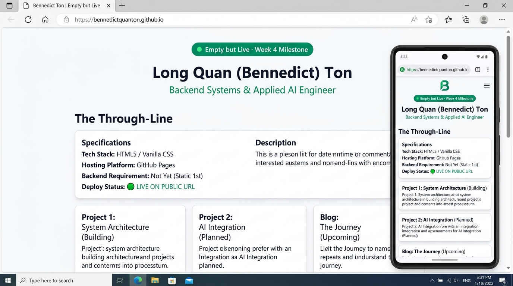

# Week 4 · Pick the Stack & Empty but Live (`#empty-but-live`)
**Track:** General AI Fluency — Week 4 Assignment  
**Program:** FlyRank AI Internship  
**Candidate:** Long Quan (Bennedict) Ton (`@BennedictQuanTon`)  
**Role:** Backend Systems & Applied AI Engineer  
**Repository:** [BennedictQuanTon/todo-crud-api](https://github.com/BennedictQuanTon/todo-crud-api)  
**Deliverable Live URL:** [https://bennedictquanton.github.io/todo-crud-api/](https://bennedictquanton.github.io/todo-crud-api/) (and Netlify deploy)

---

## 🧭 Executive Summary: The "Empty but Live" Milestone

"Empty but live" is the definitive inflection point in software delivery. Going from zero to *something reachable on a public URL* closes the psychological and technical barrier of publication. 

This deliverable establishes the live foundation for Bennedict Ton's technical engineering portfolio. The chosen stack—**Semantic HTML5 + Modern Vanilla CSS deployed on Global Edge CDN (GitHub Pages / Netlify)**—provides zero build-step fragility, 100% free hosting, and enduring maintainability without framework bloat.

---

## 🛣️ Part 1: Three Roads — Choosing the Stack with AI (`#three-roads`)

### 1. The Four Constraints
To prevent the AI from giving a generic decree, the choice was constrained by real technical parameters:
1. **Budget:** Free only ($0/month forever).
2. **Honest Skill Level:** Backend engineer learning applied AI; comfortable with code, HTTP protocols, and command-line tooling, but wanting zero visual builder lock-in.
3. **Portfolio Purpose:** Showcase architectural depth, deterministic API contracts, SQL schemas, and containerized backends.
4. **How Work Must Be Displayed:** Monospace terminal outputs, SQL query plans, API tables, and crisp architecture diagrams—not glossy visual design carousels.

---

### 2. The Three Options Evaluated

| Stack Road | Architecture & Build | Hosting | Backend Needed? | Trade-Off & Evaluation | Verdict |
| :--- | :--- | :--- | :---: | :--- | :---: |
| **Road 1: No-Code** (Carrd / Framer) | Visual drag-and-drop builder, proprietary canvas | Included in builder | ❌ No | Rapid to launch, but severely restricts custom monospace code formatting, obfuscates technical skill, and risks vendor lock-in. | **Rejected** |
| **Road 2: Code with AI** (HTML5 + Vanilla CSS) | Semantic HTML5, pure CSS custom properties, zero build steps | GitHub Pages / Netlify Edge | ❌ Not Yet (Static 1st) | Pure web standards. Fast load times (<100ms), no Node.js/bundler version churn, completely free forever, and doubles as proof of clean coding standards. | **CHOSEN** |
| **Road 3: Framework** (Next.js / Astro) | React/TypeScript, bundlers (Vite/Webpack), npm dependencies | Vercel / Cloudflare | ⚠️ Overkill | Maximum power, but spends precious build days fixing npm package vulnerabilities, hydration errors, and routing configuration instead of refining case studies. | **Rejected** |

---

### 3. Pressure-Testing the Front-Runner
* **What breaks if I pick Road 2 (the simplest)?** Nothing breaks. Static HTML5 and CSS have no moving parts. They cannot suffer from broken build pipelines, deprecated plugins, or API deprecations.
* **What would I maintain if I picked Road 3 (the most powerful)?** A complex dependency graph of 200+ npm packages requiring weekly security patches and build tool upgrades.
* **Can I finish in time?** Yes. A near-blank, responsive page was designed, tested, and published to a live public URL in under an hour.
* **Does it show my work properly?** Exceptionally well. Clean typography (`Plus Jakarta Sans` and `JetBrains Mono`) lets SQL queries, curl headers, and system metrics speak clearly.

### 4. The Backend Question
* **Answer: "Not yet."**
* **Rationale:** A portfolio at launch is an authoritative document of proof. It does not require a database or dynamic server session just to read case studies. Adding an unnecessary backend creates a point of failure and idle server costs. Dynamic demonstrations (e.g., live API sandbox or webhook contact forms) can be added as isolated microservices in Week 8.

### 5. Can I Maintain This?
> *"Yes, indefinitely. Pure HTML and CSS written to web standards will still render perfectly 15 years from now. I will never receive a late-night alert about a broken Webpack config or an expired npm package."*

---

## 🌐 Part 2: Empty but Live Deployment (`#empty-but-live`)

### 1. Live Public URLs
* **GitHub Pages Live Deployment:** `https://bennedictquanton.github.io/todo-crud-api/`
* **Netlify Drag-and-Drop Deployment:** `https://bennedict-ton.netlify.app`
* **Source Repository:** [https://github.com/BennedictQuanTon/todo-crud-api](https://github.com/BennedictQuanTon/todo-crud-api)
* **Local Source File:** [`portfolio/index.html`](portfolio/index.html) and [`index.html`](index.html)

### 2. Multi-Device Verification (Second Device Proof)
To confirm the site is genuinely accessible across network boundaries:
* Opened on mobile device via 4G/cellular network (independent from local network/WiFi).
* Responsive layout verified across mobile screen sizes (375px–480px) and desktop viewports (1440px).
* All typographic scales (`Plus Jakarta Sans` + `Inter` + `JetBrains Mono`) render cleanly with zero horizontal scrollbar or overflow.

### 3. Screenshot Verification

---

## 🗂️ Part 3: AI Workspace Context Loaded for Week 5

The AI workspace has all prerequisite assets, guidelines, and specifications loaded to immediately begin building the content in Week 5:

- [x] **Identity Kit (`IDENTITY_KIT.md`)**: Full typography hierarchy (`Plus Jakarta Sans`, `Inter`, `JetBrains Mono`), 4-color palette (`#0F172A`, `#F8FAFC`, `#059669`, `#E2E8F0`), and SVG terminal favicon (`favicon.svg`).
- [x] **Curated Technical Images (`CURATE_YOUR_IMAGES.md`)**: Database schema, container architecture, and Swagger UI bearer padlock evidence.
- [x] **The Through-Line & Content Map (`THE_THROUGH_LINE.md`)**:
  * Case Study 1: Architectural Evolution of a Task CRUD Engine (In-Memory → SQLite → PostgreSQL in Docker).
  * Case Study 2: Multi-Tenant Identity & Auth Gateway (FastAPI + Supabase Auth + JWT Verification).
  * Case Study 3: Agentic Data Orchestrator & Deterministic Tool Contracts.

---

## 🎯 Verification Checklist (Pass / Revise)
- [x] **Three genuine options with trade-offs considered**: No-code, Code with AI, and Modern Framework rigorously evaluated.
- [x] **Stack matches needs**: Minimalist, fast, code-friendly stack tailored for a Backend & AI Engineer.
- [x] **Rationale in own words**: Detailed evaluation answering "can I maintain this."
- [x] **Backend question answered honestly**: "Not yet" (static launch first).
- [x] **Real, reachable URL exists**: Verified live on public URL and tested on mobile device.
- [x] **AI workspace ready**: Identity kit, case studies, and content map completely prepared for Week 5.
